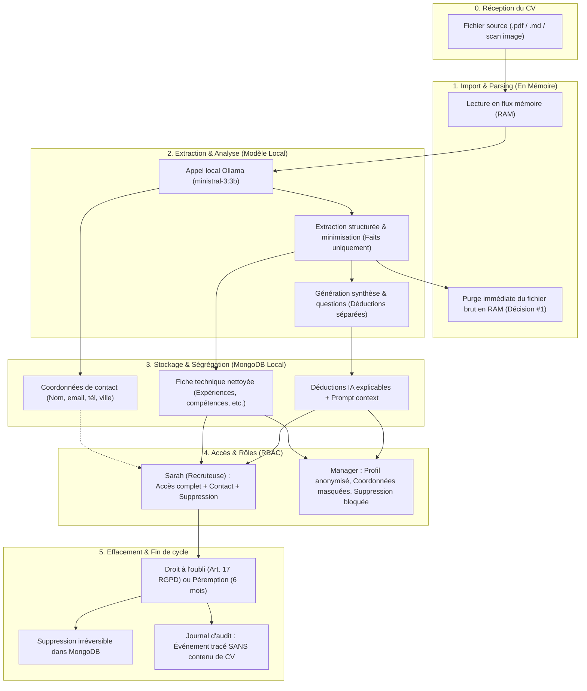

# Carte du cycle de vie des données (Data Lifecycle)

Ce document décrit le trajet réel d'un CV au sein de l'application **Atelier Nova Assistant RH**, les copies créées à chaque étape, leur localisation, et les droits d'accès associés.

---

## Tableau de traçabilité des copies et localisations

| Étape | Copie créée | Support / Emplacement | Données présentes | Durée de vie | Accès autorisé |
|---|---|---|---|---|---|
| **1. Réception** | Fichier importé | Disque local de la machine RH | CV brut d'origine (pouvant contenir âge, photo, etc.) | Temporaire (upload) | Recruteur uniquement |
| **2. Import** | Buffer binaire | RAM applicative (FastAPI) | Données brutes en mémoire tampon | Quelques millisecondes (détruit dès l'extraction) | Processus backend |
| **3. Modèle IA** | Prompt éphémère | RAM / VRAM locale (Ollama / ministral-3:3b) | Texte brut du CV (Air-gapped, zéro réseau) | Durée de l'inférence (~5-8s) | Modèle local |
| **4. Stockage Contact** | Document JSON isolé | MongoDB local (`collection: candidates.contact`) | Nom, prénom, email, téléphone, ville | 6 mois max ou jusqu'à demande d'oubli | **Recruteur uniquement** (403 pour le Manager) |
| **5. Stockage Technique** | Document JSON structuré | MongoDB local (`collection: candidates.extracted_data`) | Expériences, compétences, diplômes, langues, liens pro | 6 mois max ou jusqu'à demande d'oubli | Recruteur et Manager (anonymisé) |
| **6. Audit** | Log d'événement | MongoDB local (`collection: audit_logs`) | Timestamp, Rôle, Action (`import`, `effacement`, etc.), ID | 1 an (obligation de traçabilité) | DPO et Administrateur (**Zéro texte de CV**) |
| **7. Effacement** | **Aucune copie résiduelle** | Purge complète | Données écrasées en BDD | 0 seconde | Action irréversible |
